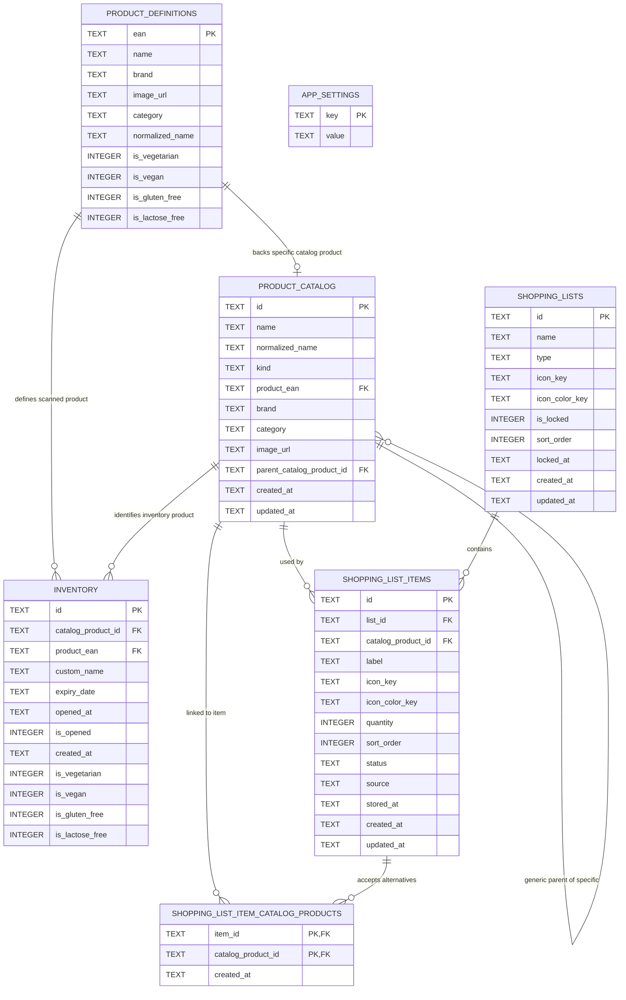

# Schemat bazy danych




## Najwazniejsze relacje

- Schemat jest tworzony w jednej transakcji, bez migracji i bez danych demonstracyjnych. Po zmianie schematu należy ręcznie wyczyścić dane instalacji deweloperskiej; zwykły restart zachowuje dane.
- `inventory.created_at` jest wymagane i zapisywane zarówno przy dodawaniu produktu, jak i finalizacji zakupów. Jedna sztuka odpowiada jednemu rekordowi.
- `inventory.catalog_product_id` wskazuje stabilne `product_catalog.id` dla produktów z EAN i bez EAN. Powiązanie jest zapisywane przy dodawaniu egzemplarza; późniejszy odczyt nie dopasowuje go po nazwie.
- Dla produktów bez EAN wspólna nazwa i metadane pochodzą z katalogu. `inventory.custom_name` pozostaje nazwą pozycji tekstowej lub kopią nazwy z momentu dodania, bez roli identyfikatora produktu.
- Finalizacja zakupów zapisuje identyfikator produktu wybranego bezpośrednio albo przez jednoznaczne powiązanie. Przy wielu alternatywach zachowuje dotychczasowy wybór jednego produktu z EAN, jeżeli taki jest jedyny; pozostałe niejednoznaczne pozycje pozostają tekstowe, z pustym `catalog_product_id`.
- Pozycje zakupowe wskazujące produkt katalogowy pokazują jego aktualną nazwę. Własne etykiety pozycji tekstowych pozostają niezależne od nazw ich alternatyw.
- Pola dietetyczne i ustawienia modelu zachowują dotychczasowe znaczenie. Początkowe `NULL` w polach dietetycznych oznacza brak klasyfikacji.
- `inventory.product_ean` wskazuje na `product_definitions.ean`, jesli produkt pochodzi ze skanu.
- `product_catalog.product_ean` wskazuje na `product_definitions.ean` dla produktow konkretnych (`specific`).
- Dla produktów bez EAN (`generic`) marka i kategoria są zapisywane w `product_catalog.brand` i `product_catalog.category`. Dla produktów `specific` odczyty katalogowe pobierają te pola z `product_definitions`.
- Ponowny zapis produktu `generic` bez marki, kategorii lub nowego zdjęcia zachowuje wcześniej zapisane wartości tych pól.
- Świadoma edycja katalogu korzysta z `ProductRepository.updateCatalogProduct(id, input)` i obejmuje nazwę, markę, kategorię i zdjęcie, wspólne dla wszystkich egzemplarzy produktu. Pusta nazwa jest odrzucana; pustą markę i kategorię zapisujemy jako `NULL`. EAN, flagi dietetyczne, identyfikatory i stan egzemplarzy pozostają zachowane. Zmiany są lokalne i nie są wysyłane do Open Food Facts.
- Pominięcie `input.imageUrl` zachowuje dotychczasowe zdjęcie, przekazanie URI je zastępuje, a `null` usuwa zdjęcie z danych produktu. Dla produktu `specific` edycja aktualizuje definicję i katalog w jednej transakcji, w tym oba pola `image_url`, aby odczyt przez `COALESCE` nie przywracał poprzedniego zdjęcia.
- `ProductRepository.saveDefinition` tworzy definicję i wpis katalogu atomowo tylko dla nowego EAN. Dla istniejącego EAN pozostawia oba rekordy bez zmian. Dodanie kolejnego egzemplarza zapisuje nowy rekord `inventory`; wspólne dane zmienia się przez edycję katalogu.
- Kolizja znormalizowanych nazw dwóch produktów `generic` daje błąd `duplicate_name`, bez scalania ich rekordów. Pusta nazwa daje `empty_name`, a brak edytowanego produktu lub definicji — `not_found`.
- `product_catalog.image_url` przechowuje zdjęcie katalogowe używane m.in. w spiżarni i listach zakupowych. Zdjęcia wybrane z aparatu lub galerii są kopiowane do prywatnego katalogu `product-photos` aplikacji, a w bazie zapisujemy URI tej kopii.
- Niezatwierdzone kopie zdjęć z edycji katalogu należą do szkicu. Anulowanie edycji usuwa jej kopie; zastąpienie lub wyczyszczenie zdjęcia w szkicu usuwa poprzednią niezatwierdzoną kopię. Sprzątane są też spóźnione i częściowe wyniki kopiowania. W trakcie zapisu plik pozostaje chroniony. Udany zapis zachowuje plik, a błąd zachowuje go do ponowienia, jeśli edytor jest otwarty, lub usuwa po zakończeniu zapisu, jeśli edytor został zamknięty. Dotychczasowe zdjęcie produktu i plik źródłowy nie są usuwane przez sprzątanie szkicu.
- `product_catalog.parent_catalog_product_id` laczy produkt konkretny z produktem ogolnym (`generic`).
- `shopping_list_items.list_id` wskazuje liste zakupow.
- `shopping_list_items.catalog_product_id` jest opcjonalne, bo zwykle pozycje tekstowe nie musza miec wpisu w katalogu.
- `shopping_list_items.icon_key` i `shopping_list_items.icon_color_key` przechowuja recznie wybrany wyglad ikony pozycji.
- `shopping_list_items.sort_order` zapisuje reczna kolejnosc produktow w konkretnej liscie.
- `shopping_list_items.status` przyjmuje `planned`, `purchased` albo `stored`; `stored` jest uzywane m.in. jako snapshot pozycji auto-listy.
- `shopping_list_item_catalog_products` pozwala podpiac produkty katalogowe jako alternatywy dla pozycji listy, np. tekstowe `mleko` moze liczyc kilka konkretnych produktow z EAN.
- `shopping_lists.icon_key` i `shopping_lists.icon_color_key` przechowuja wybrany wyglad ikony listy.
- `shopping_lists.sort_order` zapisuje reczna kolejnosc list na ekranie list zakupow.
- `app_settings` jest tabela konfiguracyjna i nie ma relacji z pozostalymi tabelami.

## Odczyt katalogu

- `ProductRepository.getCatalogProducts()` zwraca wszystkie produkty lokalnego katalogu, niezależnie od obecności w spiżarni.
- `findCatalogProductById(id)` odczytuje produkt przeznaczony do edycji po stabilnym identyfikatorze.
- `searchCatalogProducts(query, limit?)` wyszukuje fragment nazwy lub EAN. Domyślnie zwraca wszystkie dopasowania; pusty tekst zwraca cały katalog. Znaki `%`, `_` i `\` są traktowane dosłownie.
- Metody odczytu katalogu w `ShoppingListRepository` korzystają z tego samego API. Wyszukiwanie podpowiedzi zakupowych zachowuje limit 20 wyników.

## Usuwanie z katalogu

- `ProductRepository.deleteCatalogProduct(id)` usuwa wyłącznie nieużywany produkt po stabilnym ID. Edytor katalogu wymaga potwierdzenia usunięcia.
- Sprawdzenie powiązań i usunięcie odbywają się w jednej transakcji. Egzemplarze w `inventory` (także powiązane samym EAN), bezpośrednie pozycje zakupowe, alternatywy oraz produkty wskazujące ten wpis jako rodzica blokują usunięcie. Sprawdzamy wszystkie statusy pozycji zakupowych. Nie usuwamy ani nie odłączamy tych danych automatycznie.
- Dla produktu `specific` usuwamy wpis katalogu i lokalną definicję EAN atomowo; pozostawiona definicja odtworzyłaby wpis podczas uruchamiania aplikacji. Ponowne dodanie usuniętego produktu jest możliwe, a operacja nie zmienia danych w Open Food Facts.
- `CatalogProductDeleteError` rozróżnia `not_found`, `in_inventory`, `in_shopping_list` i `has_children`. Błąd zachowuje szkic edytora i pozwala ponowić operację. Błąd zapisu wycofuje całą transakcję.
- Potwierdzenie usunięcia jest osobnym widokiem tego samego dolnego panelu. Anulowanie i Wstecz przywracają szkic edycji wraz ze zdjęciem. Odmowa usunięcia pozostaje widoczna w potwierdzeniu i pozwala ponowić operację albo wrócić do edycji.
- Usunięcie produktu odrzuca jego niezatwierdzony szkic zdjęcia. Operacja nie usuwa wcześniej zapisanych plików zdjęć ani plików źródłowych; sprzątanie szkiców zachowuje dotychczasowe zasady.

## Indeksy

```sql
CREATE INDEX IF NOT EXISTS idx_inventory_catalog_product
ON inventory(catalog_product_id);

CREATE UNIQUE INDEX IF NOT EXISTS idx_product_catalog_ean
ON product_catalog(product_ean)
WHERE product_ean IS NOT NULL;

CREATE UNIQUE INDEX IF NOT EXISTS idx_product_catalog_generic_name
ON product_catalog(kind, normalized_name)
WHERE kind = 'generic';

CREATE INDEX IF NOT EXISTS idx_shopping_list_items_list_status
ON shopping_list_items(list_id, status);

CREATE INDEX IF NOT EXISTS idx_shopping_list_items_list_order
ON shopping_list_items(list_id, sort_order, created_at);

CREATE INDEX IF NOT EXISTS idx_shopping_lists_type_locked
ON shopping_lists(type, is_locked);

CREATE INDEX IF NOT EXISTS idx_shopping_item_catalog_products_catalog
ON shopping_list_item_catalog_products(catalog_product_id);
```
